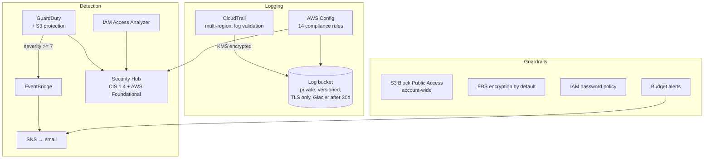

# aws-secure-baseline


Terraform that takes a brand new AWS account and locks it down the way it should've been from day one: logging, threat detection, compliance checks, encryption defaults and budget alerts. One `terraform apply` and the account goes from wide open to something I'd actually be comfortable running workloads in.

## Why

Every AWS account starts with almost nothing turned on. No GuardDuty, no Config, nothing stopping a public bucket, and CloudTrail only keeps 90 days of history in the console. Most of the breaches I've read about weren't clever hacks, they were these defaults never getting fixed.

I wanted a baseline I could re-deploy in minutes for any new account, that's version controlled, and that I can explain line by line. It's also the foundation for my other two projects:

- [aws-iam-auditor](https://github.com/CasimirTerr/aws-iam-auditor) checks the account for IAM/S3 misconfigs (I run it against this baseline to verify it)
- [cloudtrail-threat-detector](https://github.com/CasimirTerr/cloudtrail-threat-detector) alerts on attacker behavior in real time using the trail this creates

## What it sets up



| Area | What | Why |
|---|---|---|
| Logging | Multi-region CloudTrail, log file validation, own KMS key | Every API call in every region gets recorded, and I can prove the logs weren't tampered with |
| Logging | Central log bucket | Private, versioned, denies non-TLS, moves to Glacier IR after 30 days, expires after a year |
| Detection | GuardDuty + S3 protection | Catches crypto mining, credential exfiltration, recon, weird API calls |
| Detection | GuardDuty → EventBridge → email | High/critical findings get to me in minutes, not whenever I log in |
| Detection | Security Hub (CIS 1.4.0 + AWS Foundational) | One dashboard with a compliance score |
| Detection | IAM Access Analyzer | Flags anything shared outside the account |
| Compliance | AWS Config + 14 managed rules | Root MFA, user MFA, key rotation, no admin `*:*` policies, CloudTrail on, no public buckets, no open SSH, encrypted volumes, etc. |
| Guardrails | Account-level S3 Block Public Access | Nobody can make a bucket public, even by accident |
| Guardrails | EBS encryption by default | New volumes and snapshots always encrypted |
| Guardrails | Password policy | 14+ chars, complexity, no reuse of last 24, 90 day max age |
| Cost | Budget alerts at 50% actual / 100% forecast | A surprise bill is often the first sign of stolen keys |

## Layout

```
bootstrap/               state bucket (run once, local state)
versions.tf              providers + S3 backend with native locking
logging.tf               log bucket + CloudTrail
kms.tf                   KMS key for CloudTrail
threat_detection.tf      GuardDuty, alerts, Security Hub
config.tf                AWS Config recorder + rules
account_guardrails.tf    Block Public Access, EBS encryption, password policy, Access Analyzer
budget.tf                budget alerts
```

I split it by area instead of using modules. For a single account baseline it's easier to read this way, and modules would make sense once it needs to deploy to multiple accounts.

## How to deploy

Needs Terraform 1.10+, AWS CLI configured with an admin user (not root).

**1. Bootstrap the state bucket (one time)**

```bash
cd bootstrap
terraform init
terraform apply
```

Copy the `state_bucket` it prints out.

**2. Configure**

```bash
cd ..
cp backend.hcl.example backend.hcl            # paste the bucket name in here
cp terraform.tfvars.example terraform.tfvars  # put your email in here
```

**3. Deploy**

```bash
terraform init -backend-config=backend.hcl
terraform plan
terraform apply
```

**4. After**

- Click the confirmation link in the SNS email or you won't get any alerts
- Security Hub takes a few hours to run its first checks
- Test the alert pipeline: GuardDuty → Settings → **Generate sample findings**. High-severity samples should show up in your inbox

## Verifying it

I ran my [aws-iam-auditor](https://github.com/CasimirTerr/aws-iam-auditor) against the account before and after applying:

```bash
python iam_auditor.py --profile default
```

<!-- TODO: paste before/after numbers from my account here -->

## Cost

Rough numbers for a small personal/lab account:

| Service | Cost |
|---|---|
| CloudTrail (first trail, management events) | free |
| S3 log storage | cents |
| KMS key | $1/month |
| GuardDuty | 30 day free trial, then usage based (usually a few $ in a quiet account) |
| Security Hub | 30 day free trial, then per check |
| AWS Config | ~$0.003 per config item + $0.001 per rule evaluation |
| Access Analyzer, Block Public Access, EBS encryption, password policy, budgets | free |

If you only want the free stuff, set `enable_config = false` and `enable_securityhub = false`.

## Things I ran into / notes

- The state bucket has to be created separately (`bootstrap/`) since the main config stores its state in it.
- Terraform 1.10 added native S3 state locking (`use_lockfile = true`), so no DynamoDB lock table needed.
- The KMS key policy needs the account root statement or you can lock yourself out of your own key.
- Config's `include_global_resource_types` should only be true in one region, otherwise IAM resources get recorded (and billed) multiple times.
- Account-level Block Public Access overrides bucket settings, so if you ever *need* a public bucket (static site), use CloudFront with OAC instead.

## What I'd add next

- [ ] Multi-account version with AWS Organizations + delegated admin for GuardDuty/Security Hub
- [ ] CloudTrail → CloudWatch Logs metric filters for the CIS 4.x alarms
- [ ] IAM Identity Center instead of IAM users
- [ ] Turn the files into reusable modules
- [ ] Auto-remediation for a couple Config rules (public S3, open SSH)

## Author

Casimir Terrence · Cybersecurity @ Arizona State University
[LinkedIn](https://www.linkedin.com/in/casimir-terrence-a2a692428) · [GitHub](https://github.com/CasimirTerr)
